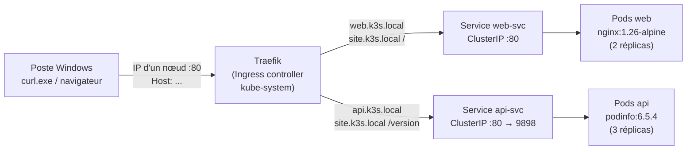
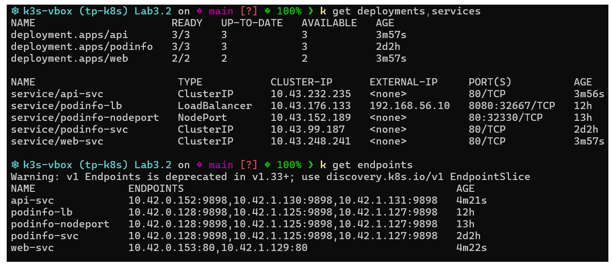
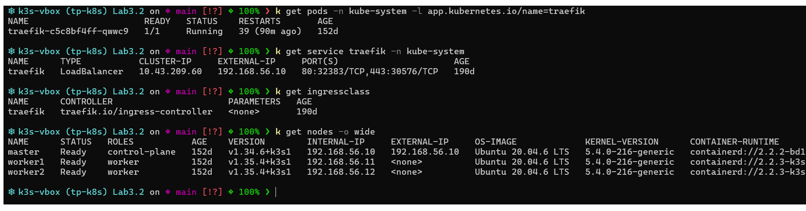
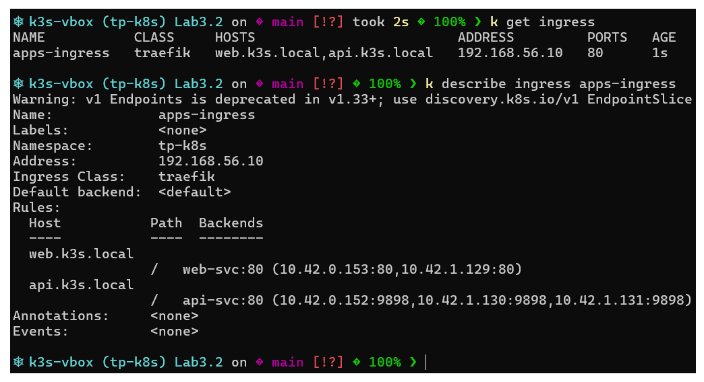
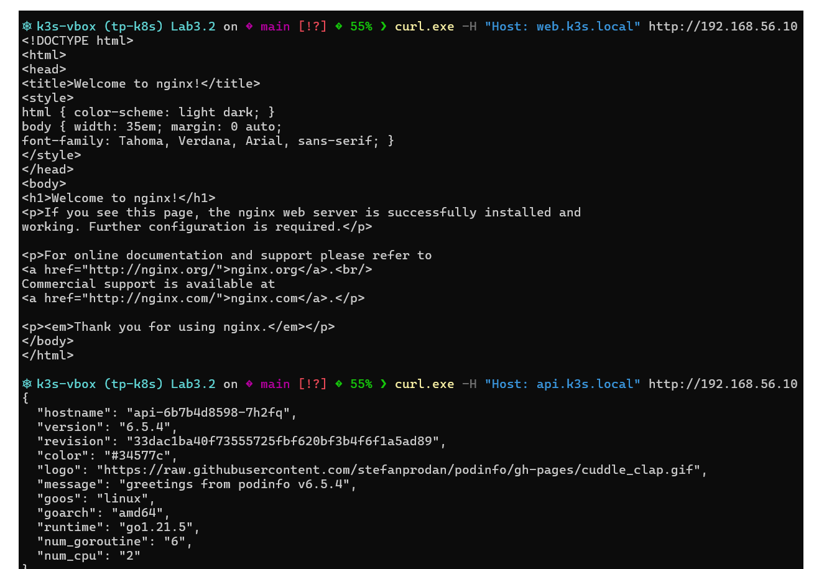
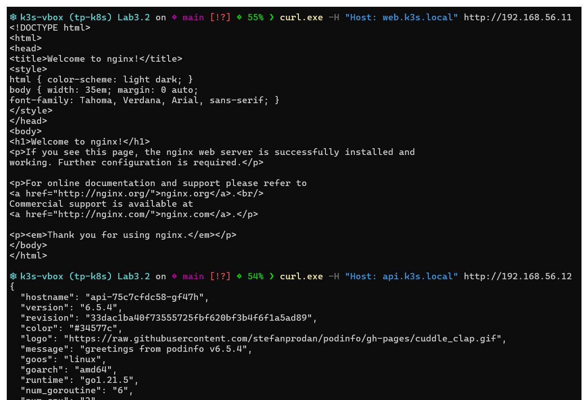
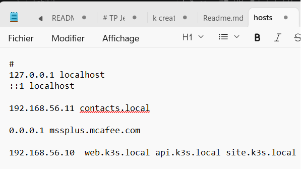
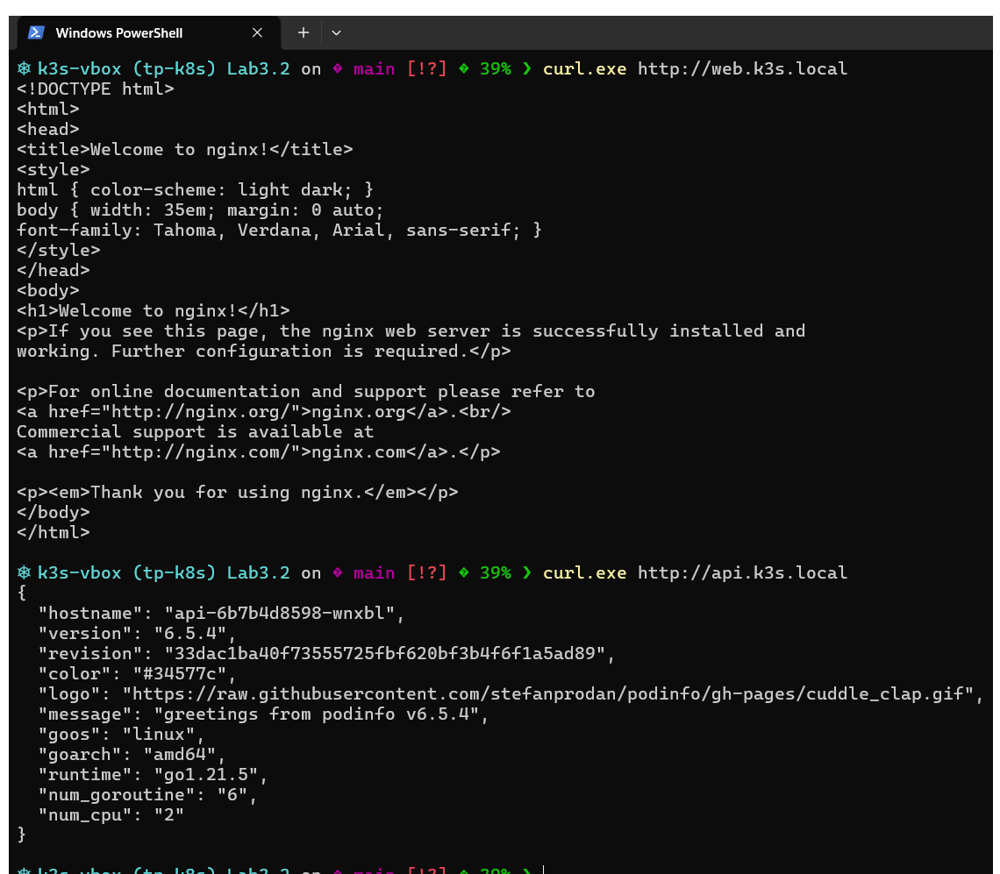
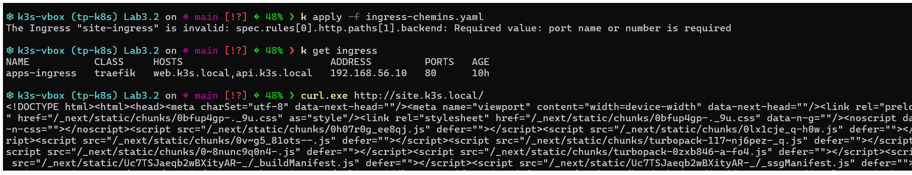
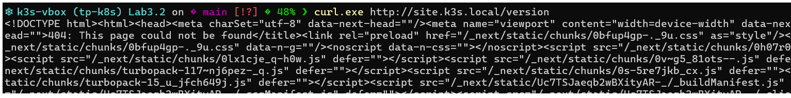

# Lab 3.2 : Ingress avec Traefik sur k3s

Exposer deux applications derrière un point d'entrée unique (Traefik) en routant par **nom d'hôte** et par **chemin**, sur un cluster k3s à 3 nœuds.

## Objectifs

- Repérer l'Ingress controller (Traefik) fourni par défaut avec k3s
- Exposer deux applications derrière un seul point d'entrée (ports 80/443)
- Router par nom d'hôte (`web.k3s.local`, `api.k3s.local`)
- Router par chemin (`site.k3s.local/` et `site.k3s.local/version`)
- Distinguer une erreur de routage d'une erreur applicative

## Architecture



### Composants

| Composant | Type | Rôle |
|---|---|---|
| Traefik | Ingress controller (Service `LoadBalancer`, ports 80/443) | Point d'entrée, routage selon hôte et chemin |
| `apps-ingress` | Ingress (classe `traefik`) | Routage par hôte : `web.k3s.local` → web-svc, `api.k3s.local` → api-svc |
| `site-ingress` | Ingress (classe `traefik`) | Routage par chemin sur `site.k3s.local` : `/` → web-svc, `/version` → api-svc |
| `web` / `web-svc` | Deployment (2 réplicas) + Service ClusterIP | Application nginx (port 80) |
| `api` / `api-svc` | Deployment (3 réplicas) + Service ClusterIP | Application podinfo (conteneur 9898, Service 80) |

### Tableau de routage

| Hôte | Chemin | Service cible | Application |
|---|---|---|---|
| web.k3s.local | `/` | web-svc:80 | nginx |
| api.k3s.local | `/` | api-svc:80 | podinfo |
| site.k3s.local | `/` | web-svc:80 | nginx |
| site.k3s.local | `/version` | api-svc:80 | podinfo |

> Le chemin n'est pas réécrit : l'application reçoit le chemin tel quel. En cas de règles multiples, le préfixe le plus long l'emporte.

## Prérequis

- Lab 3.1 réalisé, cluster k3s à 3 nœuds `Ready` (master, worker1, worker2)
- `kubectl` (alias `k`) configuré
- `curl.exe` sur le poste Windows
- Droits administrateur pour modifier le fichier `hosts` de Windows

## Structure du projet

```
.
├── apps.yaml              # Deployments + Services (web, api)
├── ingress-hotes.yaml     # Ingress apps-ingress (routage par hôte)
├── ingress-chemins.yaml   # Ingress site-ingress (routage par chemin)
└── README.md
```
# Étape 1 : Déployer les deux applications
## Déploiement

```bash
# 1. Namespace et applications
k create namespace tp-k8s
k config set-context --current --namespace=tp-k8s
k apply -f apps.yaml
k get deployments,services
k get endpoints            # web-svc : 2 endpoints, api-svc : 3
```
# Étape 2 : Repérer Traefik
```
# 2. Repérer Traefik
k get pods -n kube-system | grep traefik
k get service traefik -n kube-system
k get ingressclass
k get nodes -o wide        # noter <IP_NOEUD>
```
# Étape 3 : Créer un Ingress par nom d'hôte
```
# 3. Ingress par hôte
k apply -f ingress-hotes.yaml
k get ingress
k describe ingress apps-ingress

# 4. Routage par chemin
k apply -f ingress-chemins.yaml
```
Captures



## Tests

## Résultats observés

| Élément | Valeur relevée |
|---|---|
| Pod Traefik | `traefik-c5c8bf4ff-qwwc9`, Running (namespace kube-system) |
| Service Traefik | LoadBalancer, 80:32383/TCP et 443:30576/TCP |
| IngressClass | `traefik` |
| Pods `svclb-traefik` | 1 par nœud (3), ce qui rend le port 80 joignable sur chaque nœud |
| Nœuds | master `192.168.56.10`, worker1 `192.168.56.11`, worker2 `192.168.56.12` |
| `<IP_NOEUD>` utilisée | `192.168.56.10` |
| Endpoints | web-svc : 2, api-svc : 3 |


### Ingress par nom d'hôte

L'Ingress `apps-ingress` (classe `traefik`) contient deux règles : `web.k3s.local` → `web-svc:80` (2 endpoints) et `api.k3s.local` → `api-svc:80` (3 endpoints, port conteneur 9898). Traefik publie l'Ingress sur `192.168.56.10`, port 80.
### Avec l'en-tête Host (sans toucher au DNS)

```powershell
curl.exe -H "Host: web.k3s.local" http://<IP_NOEUD>
curl.exe -H "Host: api.k3s.local" http://<IP_NOEUD>
```
# Étape 4 : Tester avec l’en-tête Host

### Avec le fichier hosts de Windows





**Résultat :** `web.k3s.local` renvoie la page d'accueil nginx et `api.k3s.local` le JSON podinfo (v6.5.4) sur `192.168.56.10`, `.11` et `.12`, port 80. Le champ `hostname` du JSON change d'un appel à l'autre : le Service répartit les requêtes entre les 3 pods de l'API.

# Étape 5 : Utiliser de vrais noms d’hôte

Ajouter dans `C:\Windows\System32\drivers\etc\hosts` (éditeur en administrateur) :

```
192.168.56.10 web.k3s.local api.k3s.local site.k3s.local
```


```powershell
curl.exe http://web.k3s.local
curl.exe http://api.k3s.local
curl.exe http://site.k3s.local/
curl.exe http://site.k3s.local/version
```


# Étape 6 : Router par chemin






# Étape 7 : Distinguer les erreurs

````
⎈ k3s-vbox (tp-k8s) Lab3.2 on  main [!?] 󰂄 63% ❯ # a) Hôte inconnu de l'Ingress

⎈ k3s-vbox (tp-k8s) Lab3.2 on  main [!?] 󰂄 63% ❯ curl.exe -i -H "Host: inconnu.k3s.local" http://192.168.56.11
HTTP/1.1 200 OK
Content-Type: text/html; charset=utf-8
Date: Sat, 17 Oct 2026 22:04:51 GMT
Etag: "s7urre1wws56g"
Vary: Accept-Encoding
X-Powered-By: Next.js
Transfer-Encoding: chunked

<!DOCTYPE html><html><head><meta charSet="utf-8" data-next-head=""/><meta name="viewport" content="width=device-width" data-next-head=""/><link rel="preload" href="/_next/static/chunks/0bfup4gp-._9u.css" as="style"/><link rel="stylesheet" href="/_next/static/chunks/0bfup4gp-._9u.css" data-n-g=""/><noscript data-n-css=""></noscript><script src="/_next/static/chunks/0h07r0g_ee8qj.js" defer=""></script><script src="/_next/static/chunks/0lx1cje_q-h0w.js" defer=""></script><script src="/_next/static/chunks/0v~g5_81ots--.js" defer=""></script><script src="/_next/static/chunks/turbopack-117~nj6pez-_q.js" defer=""></script><script src="/_next/static/chunks/0~8nunc9q0n4-.js" defer=""></script><script src="/_next/static/chunks/turbopack-0zxb846-a-fo4.js" defer=""></script><script src="/_next/static/Uc7TSJaeqb2wBXityAR-_/_buildManifest.js" defer=""></script><script src="/_next/static/Uc7TSJaeqb2wBXityAR-_/_ssgManifest.js" defer=""></script><script src="/_next/static/Uc7TSJaeqb2wBXityAR-_/_clientMiddlewareManifest.js" defer=""></script></head><body><div id="__next"><div class="min-h-screen bg-slate-950 text-slate-50 flex flex-col font-sans selection:bg-blue-500/30"><header class="sticky top-0 z-50 w-full border-b border-white/10 bg-slate-950/80 backdrop-blur supports-[backdrop-filter]:bg-slate-950/60"><div class="container mx-auto px-4 h-16 flex items-center justify-between"><a class="flex items-center space-x-2" href="/"><span class="text-xl font-bold bg-gradient-to-r from-blue-400 to-cyan-400 bg-clip-text text-transparent">LearnFlow</span></a><nav class="hidden md:flex gap-6"><a class="text-sm font-medium text-slate-300 hover:text-white transition-colors" href="/courses">Catalogue</a><a class="text-sm font-medium text-slate-300 hover:text-white transition-colors" href="/aitutor">AI Tutor</a><a class="text-sm font-medium text-slate-300 hover:text-white transition-colors" href="/analytics">Tableau de bord</a></nav><div class="flex items-center gap-4"><a class="text-sm font-medium px-4 py-2 rounded-md bg-blue-600 hover:bg-blue-500 transition-colors shadow-lg shadow-blue-500/20" href="/users">Connexion</a></div></div></header><main class="flex-1 container mx-auto px-4 py-8"><div class="flex flex-col items-center justify-center py-20 text-center space-y-12"><div class="space-y-6 max-w-3xl"><h1 class="text-5xl md:text-7xl font-extrabold tracking-tight text-white">Apprenez avec <span class="text-transparent bg-clip-text bg-gradient-to-r from-blue-400 to-cyan-300">l&#x27;Intelligence Artificielle</span></h1><p class="text-xl text-slate-400 max-w-2xl mx-auto">Découvrez une nouvelle façon de développer vos compétences avec des cours interactifs et un tuteur IA personnel disponible 24/7.</p></div><div class="flex flex-col sm:flex-row gap-4"><a class="inline-flex items-center justify-center rounded-md text-sm font-medium ring-offset-background transition-colors focus-visible:outline-none focus-visible:ring-2 focus-visible:ring-ring focus-visible:ring-offset-2 disabled:pointer-events-none disabled:opacity-50 bg-blue-600 text-white hover:bg-blue-700 h-11 px-8 py-2 shadow-lg shadow-blue-500/30" href="/courses"><svg xmlns="http://www.w3.org/2000/svg" width="24" height="24" viewBox="0 0 24 24" fill="none" stroke="currentColor" stroke-width="2" stroke-linecap="round" stroke-linejoin="round" class="lucide lucide-book-open mr-2 h-4 w-4"><path d="M2 3h6a4 4 0 0 1 4 4v14a3 3 0 0 0-3-3H2z"></path><path d="M22 3h-6a4 4 0 0 0-4 4v14a3 3 0 0 1 3-3h7z"></path></svg> Voir le catalogue</a><a class="inline-flex items-center justify-center rounded-md text-sm font-medium ring-offset-background transition-colors focus-visible:outline-none focus-visible:ring-2 focus-visible:ring-ring focus-visible:ring-offset-2 disabled:pointer-events-none disabled:opacity-50 border border-slate-700 bg-slate-900 text-slate-100 hover:bg-slate-800 h-11 px-8 py-2" href="/aitutor"><svg xmlns="http://www.w3.org/2000/svg" width="24" height="24" viewBox="0 0 24 24" fill="none" stroke="currentColor" stroke-width="2" stroke-linecap="round" stroke-linejoin="round" class="lucide lucide-brain-circuit mr-2 h-4 w-4"><path d="M12 4.5a2.5 2.5 0 0 0-4.96-.46 2.5 2.5 0 0 0-1.98 3 2.5 2.5 0 0 0-1.32 4.24 3 3 0 0 0 .34 5.58 2.5 2.5 0 0 0 2.96 3.08 2.5 2.5 0 0 0 4.91.05L12 20V4.5Z"></path><path d="M16 8V5c0-1.1.9-2 2-2"></path><path d="M12 13h4"></path><path d="M12 18h6a2 2 0 0 1 2 2v1"></path><path d="M12 8h8"></path><path d="M20.5 8a.5.5 0 1 1-1 0 .5.5 0 0 1 1 0Z"></path><path d="M16.5 13a.5.5 0 1 1-1 0 .5.5 0 0 1 1 0Z"></path><path d="M20.5 21a.5.5 0 1 1-1 0 .5.5 0 0 1 1 0Z"></path><path d="M18.5 3a.5.5 0 1 1-1 0 .5.5 0 0 1 1 0Z"></path></svg> Essayer l&#x27;AI Tutor</a></div><div class="grid grid-cols-1 md:grid-cols-3 gap-8 w-full mt-20"><div class="p-6 rounded-2xl bg-white/5 border border-white/10 backdrop-blur-sm text-left"><h3 class="text-lg font-semibold text-white mb-2">Microservices Modernes</h3><p class="text-slate-400 text-sm">Architecture robuste propulsée par FastAPI, Node.js et Next.js.</p></div><div class="p-6 rounded-2xl bg-gradient-to-br from-blue-500/10 to-purple-500/10 border border-blue-500/20 backdrop-blur-sm text-left relative overflow-hidden"><div class="absolute top-0 right-0 p-4 opacity-10"><svg xmlns="http://www.w3.org/2000/svg" width="64" height="64" viewBox="0 0 24 24" fill="none" stroke="currentColor" stroke-width="2" stroke-linecap="round" stroke-linejoin="round" class="lucide lucide-brain-circuit "><path d="M12 4.5a2.5 2.5 0 0 0-4.96-.46 2.5 2.5 0 0 0-1.98 3 2.5 2.5 0 0 0-1.32 4.24 3 3 0 0 0 .34 5.58 2.5 2.5 0 0 0 2.96 3.08 2.5 2.5 0 0 0 4.91.05L12 20V4.5Z"></path><path d="M16 8V5c0-1.1.9-2 2-2"></path><path d="M12 13h4"></path><path d="M12 18h6a2 2 0 0 1 2 2v1"></path><path d="M12 8h8"></path><path d="M20.5 8a.5.5 0 1 1-1 0 .5.5 0 0 1 1 0Z"></path><path d="M16.5 13a.5.5 0 1 1-1 0 .5.5 0 0 1 1 0Z"></path><path d="M20.5 21a.5.5 0 1 1-1 0 .5.5 0 0 1 1 0Z"></path><path d="M18.5 3a.5.5 0 1 1-1 0 .5.5 0 0 1 1 0Z"></path></svg></div><h3 class="text-lg font-semibold text-white mb-2">AI Tutor Intégré</h3><p class="text-slate-400 text-sm">Posez des questions contextuelles et recevez des quiz générés par l&#x27;IA.</p></div><div class="p-6 rounded-2xl bg-white/5 border border-white/10 backdrop-blur-sm text-left"><h3 class="text-lg font-semibold text-white mb-2">Analytics &amp; Feedback</h3><p class="text-slate-400 text-sm">Suivez vos progrès et automatisez vos feedbacks avec n8n.</p></div></div></div></main></div></div><script id="__NEXT_DATA__" type="application/json">{"props":{"pageProps":{}},"page":"/","query":{},"buildId":"Uc7TSJaeqb2wBXityAR-_","nextExport":true,"autoExport":true,"isFallback":false,"scriptLoader":[]}</script></body></html>

⎈ k3s-vbox (tp-k8s) Lab3.2 on  main [!?] 󰂄 64% ❯ # b) Chemin inexistant dans l'application nginx

⎈ k3s-vbox (tp-k8s) Lab3.2 on  main [!?] 󰂄 66% ❯ curl.exe -i http://web.k3s.local/nexiste-pas
HTTP/1.1 404 Not Found
Content-Length: 153
Content-Type: text/html
Date: Sat, 17 Oct 2026 22:06:20 GMT
Server: nginx/1.31.6

<html>
<head><title>404 Not Found</title></head>
<body>
<center><h1>404 Not Found</h1></center>
<hr><center>nginx/1.31.6</center>
</body>
</html>

⎈ k3s-vbox (tp-k8s) Lab3.2 on  main [!?] 󰂄 66% ❯

⎈ k3s-vbox (tp-k8s) Lab3.2 on  main [!?] 󰂄 66% ❯ # c) Service sans aucun Pod

⎈ k3s-vbox (tp-k8s) Lab3.2 on  main [!?] 󰂄 66% ❯ k scale deployment api --replicas=0
deployment.apps/api scaled

⎈ k3s-vbox (tp-k8s) Lab3.2 on  main [!?] 󰂄 66% ❯ curl.exe -i http://api.k3s.local
HTTP/1.1 200 OK
Content-Length: 388
Content-Type: application/json; charset=utf-8
Date: Sat, 17 Oct 2026 22:06:23 GMT
X-Content-Type-Options: nosniff

{
  "hostname": "api-75c7cfdc58-gf47h",
  "version": "6.5.4",
  "revision": "33dac1ba40f73555725fbf620bf3b4f6f1a5ad89",
  "color": "#34577c",
  "logo": "https://raw.githubusercontent.com/stefanprodan/podinfo/gh-pages/cuddle_clap.gif",
  "message": "greetings from podinfo v6.5.4",
  "goos": "linux",
  "goarch": "amd64",
  "runtime": "go1.21.5",
  "num_goroutine": "6",
  "num_cpu": "2"
}

⎈ k3s-vbox (tp-k8s) Lab3.2 on  main [!?] 󰂄 66% ❯ k scale deployment api --replicas=3
deployment.apps/api scaled
````
| Cas | Commande | Origine de la réponse |
|---|---|---|
| a) Hôte inconnu | `curl.exe -i -H "Host: inconnu.k3s.local" http://<IP_NOEUD>` | Traefik : aucune règle ne correspond |
| b) Chemin inexistant | `curl.exe -i http://web.k3s.local/nexiste-pas` | nginx : routage correct, page absente |
| c) Service sans Pod | `k scale deployment api --replicas=0` puis `curl.exe -i http://api.k3s.local` | Traefik : règle présente, aucun backend |

Remettre ensuite `k scale deployment api --replicas=3`.

## Points de contrôle

- [ ] 5 Pods `Running` ; 2 endpoints pour web-svc, 3 pour api-svc
- [ ] Traefik `Running`, Service de type `LoadBalancer` (80/443)
- [ ] Ingress `apps-ingress` et `site-ingress` créés
- [ ] Chaque hôte renvoie la bonne application, sur n'importe quel nœud
- [ ] `/` → nginx et `/version` → API sur `site.k3s.local`
- [ ] Trois réponses d'erreur différentes (a, b, c) comprises

## Nettoyage

```bash
k delete namespace tp-k8s
```
Pensez aussi à retirer les lignes `*.k3s.local` du fichier `hosts`.

## Pistes d'amélioration

- Ajouter TLS (port 443) avec un certificat auto-signé ou cert-manager
- Middlewares Traefik (redirection HTTP→HTTPS, réécriture de chemin)
- Dashboard Traefik pour visualiser les routeurs
- Automatiser le déploiement (Ansible / Argo CD)

## Auteur

Ferid Saad : Master DevOps & Cloud, ISET Tozeur
