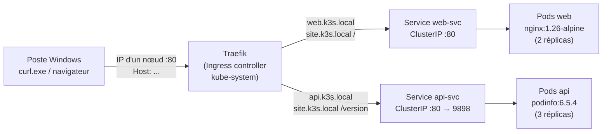

# Lab 3.2 : Ingress avec Traefik sur k3s

Exposer deux applications derrière un point d'entrée unique (Traefik) en routant par **nom d'hôte** et par **chemin**, sur un cluster k3s à 3 nœuds.

## Objectifs

- Repérer l'Ingress controller (Traefik) fourni par défaut avec k3s
- Exposer deux applications derrière un seul point d'entrée (ports 80/443)
- Router par nom d'hôte (`web.k3s.local`, `api.k3s.local`)
- Router par chemin (`site.k3s.local/` et `site.k3s.local/version`)
- Distinguer une erreur de routage d'une erreur applicative

## Architecture



### Composants

| Composant | Type | Rôle |
|---|---|---|
| Traefik | Ingress controller (Service `LoadBalancer`, ports 80/443) | Point d'entrée, routage selon hôte et chemin |
| `apps-ingress` | Ingress (classe `traefik`) | Routage par hôte : `web.k3s.local` → web-svc, `api.k3s.local` → api-svc |
| `site-ingress` | Ingress (classe `traefik`) | Routage par chemin sur `site.k3s.local` : `/` → web-svc, `/version` → api-svc |
| `web` / `web-svc` | Deployment (2 réplicas) + Service ClusterIP | Application nginx (port 80) |
| `api` / `api-svc` | Deployment (3 réplicas) + Service ClusterIP | Application podinfo (conteneur 9898, Service 80) |

### Tableau de routage

| Hôte | Chemin | Service cible | Application |
|---|---|---|---|
| web.k3s.local | `/` | web-svc:80 | nginx |
| api.k3s.local | `/` | api-svc:80 | podinfo |
| site.k3s.local | `/` | web-svc:80 | nginx |
| site.k3s.local | `/version` | api-svc:80 | podinfo |

> Le chemin n'est pas réécrit : l'application reçoit le chemin tel quel. En cas de règles multiples, le préfixe le plus long l'emporte.

## Prérequis

- Lab 3.1 réalisé, cluster k3s à 3 nœuds `Ready` (master, worker1, worker2)
- `kubectl` (alias `k`) configuré
- `curl.exe` sur le poste Windows
- Droits administrateur pour modifier le fichier `hosts` de Windows

## Structure du projet

```
.
├── apps.yaml              # Deployments + Services (web, api)
├── ingress-hotes.yaml     # Ingress apps-ingress (routage par hôte)
├── ingress-chemins.yaml   # Ingress site-ingress (routage par chemin)
└── README.md
```

## Déploiement

```bash
# 1. Namespace et applications
k create namespace tp-k8s
k config set-context --current --namespace=tp-k8s
k apply -f apps.yaml
k get deployments,services
k get endpoints            # web-svc : 2 endpoints, api-svc : 3

# 2. Repérer Traefik
k get pods -n kube-system | grep traefik
k get service traefik -n kube-system
k get ingressclass
k get nodes -o wide        # noter <IP_NOEUD>

# 3. Ingress par hôte
k apply -f ingress-hotes.yaml
k get ingress
k describe ingress apps-ingress

# 4. Routage par chemin
k apply -f ingress-chemins.yaml
```

## Tests

### Avec l'en-tête Host (sans toucher au DNS)

```powershell
curl.exe -H "Host: web.k3s.local" http://<IP_NOEUD>
curl.exe -H "Host: api.k3s.local" http://<IP_NOEUD>
```

### Avec le fichier hosts de Windows

Ajouter dans `C:\Windows\System32\drivers\etc\hosts` (éditeur en administrateur) :

```
<IP_NOEUD>  web.k3s.local api.k3s.local site.k3s.local
```

```powershell
curl.exe http://web.k3s.local
curl.exe http://api.k3s.local
curl.exe http://site.k3s.local/
curl.exe http://site.k3s.local/version
```

### Distinguer les erreurs

| Cas | Commande | Origine de la réponse |
|---|---|---|
| a) Hôte inconnu | `curl.exe -i -H "Host: inconnu.k3s.local" http://<IP_NOEUD>` | Traefik : aucune règle ne correspond |
| b) Chemin inexistant | `curl.exe -i http://web.k3s.local/nexiste-pas` | nginx : routage correct, page absente |
| c) Service sans Pod | `k scale deployment api --replicas=0` puis `curl.exe -i http://api.k3s.local` | Traefik : règle présente, aucun backend |

Remettre ensuite `k scale deployment api --replicas=3`.

## Points de contrôle

- [ ] 5 Pods `Running` ; 2 endpoints pour web-svc, 3 pour api-svc
- [ ] Traefik `Running`, Service de type `LoadBalancer` (80/443)
- [ ] Ingress `apps-ingress` et `site-ingress` créés
- [ ] Chaque hôte renvoie la bonne application, sur n'importe quel nœud
- [ ] `/` → nginx et `/version` → API sur `site.k3s.local`
- [ ] Trois réponses d'erreur différentes (a, b, c) comprises

## Nettoyage

```bash
k delete namespace tp-k8s
```
Pensez aussi à retirer les lignes `*.k3s.local` du fichier `hosts`.

## Pistes d'amélioration

- Ajouter TLS (port 443) avec un certificat auto-signé ou cert-manager
- Middlewares Traefik (redirection HTTP→HTTPS, réécriture de chemin)
- Dashboard Traefik pour visualiser les routeurs
- Automatiser le déploiement (Ansible / Argo CD)

## Auteur

Ferid Saad : Master DevOps & Cloud, ISET Tozeur
